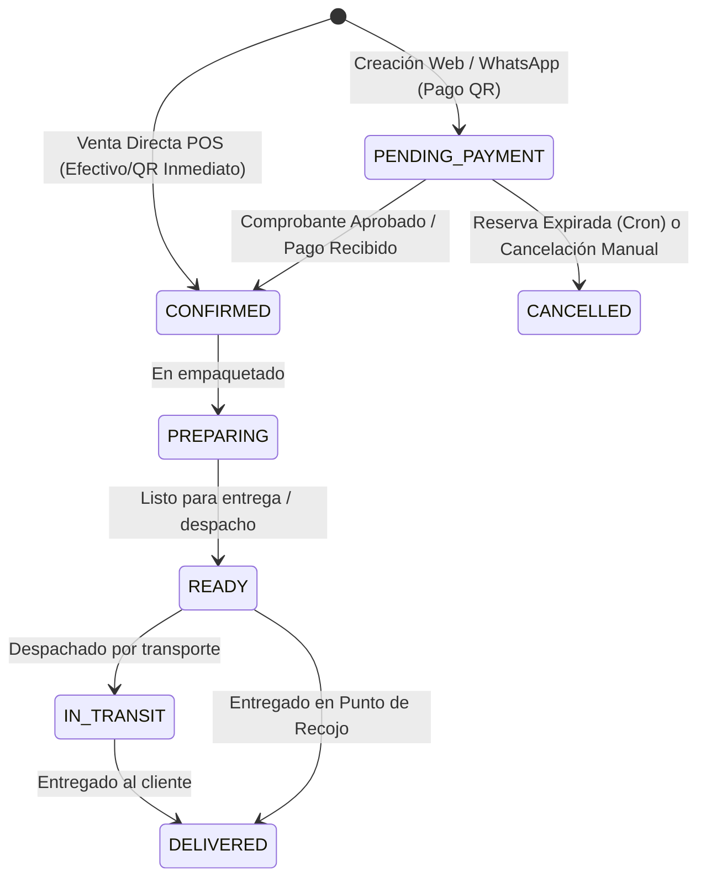

# Documentación Integral del Sistema y Guía de Integración para Agentes (Control Ventas)

> **Destinatarios:** Agentes de Inteligencia Artificial, desarrolladores backend/frontend y creadores de integraciones satélite (Tienda Web, App Móvil Flutter/React Native, Agentes Inteligentes de WhatsApp, Terminales POS, Bots y Microservicios).  
> **Versión del Sistema:** 1.0 (Next.js 15 App Router / MongoDB Atlas)  
> **Ámbito Geográfico & Moneda:** Bolivia (La Paz y Envíos Nacionales) | Moneda: Bolivianos (`Bs` / `BOB`) | Zona horaria: `America/La_Paz` (UTC-4).

---

## Índice

1. [Visión General y Propósito del Sistema](#1-visión-general-y-propósito-del-sistema)
2. [Arquitectura y Tecnologías](#2-arquitectura-y-tecnologías)
3. [Seguridad y Estrategias de Autenticación](#3-seguridad-y-estrategias-de-autenticación)
4. [Modelo de Datos y Entidades Centrales](#4-modelo-de-datos-y-entidades-centrales)
5. [Reglas de Negocio Críticas y Flujos Operativos](#5-reglas-de-negocio-críticas-y-flujos-operativos)
   - [5.1 Gestión de Stock (Disponible vs Reservado)](#51-gestión-de-stock-disponible-vs-reservado)
   - [5.2 Ciclo de Vida de Pedidos y Estados](#52-ciclo-de-vida-de-pedidos-y-estados)
   - [5.3 Logística y Métodos de Entrega](#53-logística-y-métodos-de-entrega)
   - [5.4 Flujo de Pagos QR y Aprobación Rápida](#54-flujo-de-pagos-qr-y-aprobación-rápida)
   - [5.5 Cron de Liberación de Reservas Expiradas](#55-cron-de-liberación-de-reservas-expiradas)
6. [Guía de Integración por Tipo de Agente / Aplicación Satélite](#6-guía-de-integración-por-tipo-de-agente--aplicación-satélite)
   - [6.1 Agente / Bot de Ventas de WhatsApp](#61-agente--bot-de-ventas-de-whatsapp)
   - [6.2 Aplicación Móvil (Clientes y Vendedores/POS)](#62-aplicación-móvil-clientes-y-vendedorespos)
   - [6.3 Frontend Web E-Commerce Externo](#63-frontend-web-e-commerce-externo)
   - [6.4 Workers / Tareas Programadas](#64-workers--tareas-programadas)
7. [Catálogo Maestro de Endpoints (API Reference)](#7-catálogo-maestro-de-endpoints-api-reference)
8. [Variables de Entorno y Configuración](#8-variables-de-entorno-y-configuración)
9. [Gotchas, Buenas Prácticas y Errores Frecuentes](#9-gotchas-buenas-prácticas-y-errores-frecuentes)

---

## 1. Visión General y Propósito del Sistema

**Control Ventas** es un sistema omnicanal de gestión comercial especializado en indumentaria (chompas, abrigos y prendas de vestir), diseñado para operar tanto en puntos físicos como a través de canales digitales en Bolivia.

### Canales Soportados (`canal`):
- `WEB`: Tienda online donde clientes navegan el catálogo, usan carrito persistente y realizan checkout.
- `APP_QR`: Ventas asistidas o realizadas vía aplicación móvil mediante escaneo de códigos de barra o QR.
- `TIENDA`: Terminal de Punto de Venta (POS) presencial para ventas de mostrador directas.
- `WHATSAPP`: Pedidos generados por bots conversacionales o atención de ventas por mensajería.

### Propósito para Agentes Satélite:
Cualquier cliente nuevo (ej. un agente de IA para WhatsApp en Node.js/Python, una app móvil en Flutter/React Native o una landing page externa) **debe interactuar con este backend como fuente única de la verdad**, consumiendo sus endpoints HTTP REST y respetando la lógica de stock transaccional, estados de pedidos y políticas de pago.

---

## 2. Arquitectura y Tecnologías

El núcleo del sistema está estructurado con principios de **Clean Architecture Modular** en Next.js 15:

```
src/
├── app/api/               # Capa HTTP (Controladores REST en App Router)
│   ├── auth/              # Login, signup, google, NextAuth
│   ├── carrito/           # Carrito del cliente autenticado
│   ├── delivery-options/  # Puntos de encuentro, horarios y flotas
│   ├── integrations/      # Endpoints específicos para integraciones (WhatsApp)
│   ├── pedidos/           # Checkout, consulta y actualización de pedidos
│   ├── pagos/             # Transacciones financieras, comprobantes y reembolsos
│   ├── pos/               # Ventas presenciales y escaneo de códigos
│   ├── productos/         # Catálogo público y gestión interna de productos
│   └── verificar/         # Rutas públicas con token de aprobación de comprobantes
├── modules/               # Capa de Dominio y Aplicación (Lógica de Negocio)
│   ├── cart/              # Servicios de carrito y validación previa a checkout
│   ├── catalog/           # Búsqueda y gestión de productos/variantes
│   ├── integrations/      # whatsapp.service.ts (orquestación del bot)
│   ├── inventory/         # Kárdex, movimientos y reservas atómicas de stock
│   ├── orders/            # pedidos.service.ts (creación, estados, sincronización)
│   ├── payments/          # payments.service.ts (verificación y tokens)
│   └── pos/               # pos.service.ts (ventas de mostrador y métricas vendedor)
├── models/                # Esquemas y Modelos Mongoose (Persistencia MongoDB)
├── schemas/               # Contratos y validaciones con Zod (Validación de entrada)
├── libs/                  # Clientes externos: MongoDB, Cloudinary, Telegram
└── shared/                # Manejadores de errores (AppError), transacciones DB
```

### Tecnologías Clave:
- **Framework:** Next.js 15 (Node.js runtime).
- **Base de Datos:** MongoDB Atlas a través de Mongoose 8. Las operaciones críticas ejecutan transacciones ACID (`runInTransaction`).
- **Almacenamiento Multimedia:** Cloudinary (imágenes de prendas, variantes y comprobantes bancarios).
- **Notificaciones Inmediatas:** Telegram Bot API (alertas al admin sobre nuevos pagos y pedidos con enlaces de revisión) y WhatsApp (mensajes formateados para derivación humana).
- **Validación de Datos:** Zod. Todas las entradas son sanitizadas estrictamente antes de llegar a la capa de aplicación.

---

## 3. Seguridad y Estrategias de Autenticación

El sistema admite **3 mecanismos de autenticación**, adaptados según el tipo de cliente consumidor:

### 3.1 Clientes Desacoplados (App Móvil, Web SPA Externa, Microservicios)
- **Método:** JWT Bearer Token.
- **Header requerido:** `Authorization: Bearer <accessToken>`
- **Generación:**
  - `POST /api/auth/login` con `{ "email": "...", "password": "..." }`
  - `POST /api/auth/google` con `{ "idToken": "..." }`
- **Expiración:** `1d` (configurada en `JWT_EXPIRES_IN`).
- **Payload decodificado:** `{ id, email, rol, nombreCompleto, iat, exp }`.

### 3.2 Agente de WhatsApp / Integraciones de Backend a Backend
- **Método:** API Key fija enviada por Bearer token.
- **Header requerido:** `Authorization: Bearer <WHATSAPP_INTEGRATION_API_KEY>`
- **Verificación:** Comparación criptográfica segura en tiempo constante (`crypto.timingSafeEqual`) en `src/modules/integrations/whatsapp/whatsapp.service.ts`.
- **Endpoints exclusivos:**
  - `POST /api/integrations/whatsapp/orders`
  - `GET /api/integrations/whatsapp/orders/[numeroPedido]?phone=...`
  - `POST /api/integrations/whatsapp/payments/[paymentId]/proof`

### 3.3 Dashboard Web Interno (NextAuth)
- Sesiones por cookie `httpOnly` gestionadas por NextAuth v4.
- El archivo `src/middleware.ts` inyecta automáticamente los headers `x-user-id` y `x-user-role` a las rutas de API.

### 3.4 Roles del Sistema (`rol`):
| Rol | Alcance |
|---|---|
| `CLIENTE` | Acceso a catálogo público, su propio carrito, sus pedidos, sus direcciones y subida de comprobantes propios. |
| `VENDEDOR` | Todo lo de cliente + acceso al módulo POS, escaneo de variantes, ventas directas, catálogo interno y gestión operativa de pedidos/entregas. |
| `ADMIN` | Control total: gestión de usuarios, auditoría, reportes financieros, configuración de logística y ops. |

### 3.5 Rate Limiting (Protección contra abusos)
El middleware aplica rate limit en memoria:
- Auth (`login`, `signup`): **5 req/min** por IP.
- Catálogo público (`/api/productos/publicos`): **100 req/min** por IP.
- APIs autenticadas GET: **60 req/min** por usuario.
- APIs autenticadas POST/PUT/DELETE: **30 req/min** por usuario.
- Si se excede: HTTP `429 Too Many Requests` con header `Retry-After: 60`. Los agentes deben implementar reintentos con backoff exponencial.

---

## 4. Modelo de Datos y Entidades Centrales

### 4.1 `Producto` y `Variante` (`src/models/producto.ts`)
Los productos representan prendas de vestir estructuradas por variantes (combinación de color, talla y código de barras/QR).

```typescript
// Estructura de Variante
{
  varianteId: string;           // Identificador único de variante (ObjectId en string)
  color: string;                // Ej: "Azul Marino"
  colorSecundario?: string;     // Ej: "Gris"
  talla: string;                // Ej: "M", "L", "XL", "Standard"
  stock: number;                // Stock físico total
  stockReservado: number;       // Stock apartado pendiente de pago
  descripcion?: string;
  imagenes: string[];           // URLs de Cloudinary
  codigoBarra?: string;         // Código de barras físico (EAN/Code128)
  qrCode?: string;              // Código QR único para escaneo POS
}

// Estructura de Producto
{
  _id: ObjectId;
  nombre: string;               // Ej: "Chompa Clásica de Alpaca"
  modelo: string;               // Ej: "Alpaca-2026"
  categoria: string;            // Default: "Chompas"
  descripcion?: string;
  sku: string;                  // Único e inmutable
  precioVenta: number;          // Precio al público (Bs)
  precioCosto: number;          // Costo de fabricación (Bs)
  descuento: number;            // Porcentaje de descuento (0 a 100)
  variantes: Variante[];
  stockTotal: number;
  stockMinimo: number;          // Umbral de alerta
  totalVendidos: number;
  estado: "ACTIVO" | "INACTIVO" | "AGOTADO";
}
```

### 4.2 `Pedido` (`src/models/pedido.ts`)
Es el documento central de venta unificada para todos los canales.

```typescript
{
  numeroPedido: string;         // Generado automáticamente: "P-XXXXXXXX"
  canal: "WEB" | "APP_QR" | "TIENDA" | "WHATSAPP";
  estadoPedido: "PENDING_PAYMENT" | "CONFIRMED" | "PREPARING" | "READY" | "IN_TRANSIT" | "DELIVERED" | "CANCELLED";
  estadoPago: "PENDING" | "PAID" | "FAILED" | "REFUNDED";
  estadoEntrega: "PENDING" | "READY" | "IN_TRANSIT" | "DELIVERED" | "NOT_APPLICABLE" | "CANCELLED";
  estadoReservaStock: "NONE" | "RESERVED" | "CONSUMED" | "RELEASED";
  reservadoEn: Date | null;
  reservaExpiraEn: Date | null; // Fecha límite para pagar antes de que el cron libere el stock
  metodoPago: "EFECTIVO" | "QR";
  cliente: ObjectId | null;     // Referencia a User si está registrado
  vendedor: ObjectId | null;    // Referencia a User (staff que atendió o registró)
  idempotencyKey?: string;      // Clave anti-duplicados (única y dispersa)
  
  snapshotCliente: {
    usuarioId?: ObjectId;
    nombreCompleto: string;
    email?: string;
    telefono?: string;
    tipoDocumento?: "CI" | "NIT" | "PASAPORTE" | "OTRO";
    numeroDocumento?: string;
  };
  
  snapshotEntrega: {
    metodo: "WHATSAPP" | "PICKUP_POINT" | "SHIPPING_NATIONAL" | null;
    puntoRecojo?: string;       // Nombre del punto (si PICKUP_POINT)
    direccion?: string;
    telefono?: string;
    nombreDestinatario?: string;
    programadoPara?: string;    // Fecha/horario acordado (YYYY-MM-DD o texto)
    departamento?: string;      // Si SHIPPING_NATIONAL (ej: "Santa Cruz", "Cochabamba")
    ciudad?: string;
    empresaEnvio?: string;      // Empresa de transporte (ej: "Trans Copacabana")
    sucursal?: string;
    ciRemitente?: string;       // C.I. del destinatario requerido para encomiendas
  };

  items: [{
    productoId: ObjectId;
    variante: {
      varianteId?: string;
      color: string;
      colorSecundario?: string;
      talla: string;
      codigoBarra?: string;
      qrCode?: string;
    };
    productoSnapshot: { nombre: string; modelo?: string; sku?: string; imagen?: string; };
    cantidad: number;
    precioUnitario: number;
    totalLinea: number;
    precioCosto: number;
    ganancia: number;
  }];

  subtotal: number;
  costoEnvio: number;           // 0 Bs para PICKUP_POINT, 10 Bs para SHIPPING_NATIONAL
  descuento: number;
  total: number;                // subtotal + costoEnvio - descuento
  gananciaTotal: number;
  notas?: string;
  motivoCancelacion?: string;
}
```

### 4.3 `TransaccionPago` (`src/models/transaccionPago.ts`)
Gestiona el estado financiero de cada cobro.

```typescript
{
  numeroPago: string;           // "PAGO-XXXXXXXX"
  pedidoId: ObjectId;           // Ref a Pedido
  cliente?: ObjectId;
  metodoPago: "EFECTIVO" | "QR";
  monto: number;
  estado: "PENDING" | "PAID" | "FAILED" | "REFUNDED";
  idempotencyKey?: string;
  urlComprobante?: string;      // URL en Cloudinary de la captura del QR
  tokenRevision?: string;       // Token único para URL de aprobación rápida
  tokenRevisionExpiresAt?: Date;
  tokenRevisionUsedAt?: Date;
  tokenRevisionUsedBy?: ObjectId;
}
```

### 4.4 `Entrega` (`src/models/entrega.ts`)
Refleja la logística operativa vinculada al pedido.
- Creado o sincronizado en simultáneo con el pedido cuando el canal requiere despacho (`WHATSAPP`, `PICKUP_POINT`, `SHIPPING_NATIONAL`).
- Para ventas POS inmediatas en tienda, su estado en el pedido se fija como `NOT_APPLICABLE`.

### 4.5 `DeliveryOptions` (`src/models/deliveryOptions.ts`)
Documento único (`key: "default"`) administrable que contiene la configuración oficial de opciones de entrega:
- `pickupPoints`: Lista de puntos de encuentro aprobados (id, name).
- `pickupSchedules`: Días y rangos de horario permitidos para recojo.
- `shippingCompanies`: Empresas de envío nacionales autorizadas con sus departamentos y sucursales.

---

## 5. Reglas de Negocio Críticas y Flujos Operativos

### 5.1 Gestión de Stock (Disponible vs Reservado)
Para evitar sobreventas entre la web, la tienda física y los bots de WhatsApp:
1. **Fórmula de disponibilidad:**  
   $$\text{Stock Disponible} = \max(0, \text{variante.stock} - \text{variante.stockReservado})$$
2. **Reserva temporal:**  
   Al crear un pedido vía Web Checkout o vía WhatsApp, el stock **no se deduce físicamente de inmediato**; se incrementa `stockReservado` en la variante y el pedido se marca como `estadoReservaStock: "RESERVED"`.
3. **Consumo definitivo:**  
   Al confirmarse el pago (vía staff o aprobación de comprobante QR), se ejecuta:
   - `variante.stock -= cantidad`
   - `variante.stockReservado -= cantidad`
   - `estadoReservaStock = "CONSUMED"`
   - Se crea un registro en `Inventario` con `tipo: "SALIDA"` y referencia al pedido.
4. **Liberación:**  
   Si el pedido se cancela o vence el tiempo de reserva, se restaura el reservado:
   - `variante.stockReservado -= cantidad`
   - `estadoReservaStock = "RELEASED"`

### 5.2 Ciclo de Vida de Pedidos y Estados



- **Invariante de Pago:** No se debe pasar una entrega a `IN_TRANSIT` ni `DELIVERED` si `estadoPago` no es `PAID`, salvo ventas autorizadas en efectivo de mostrador.

### 5.3 Logística y Métodos de Entrega
1. **Punto de Recojo (`PICKUP_POINT`):**
   - Requiere: `puntoRecojo` (o `pickupPointId`), `horarioRecojo` (o `pickupScheduleId`), `telefono` y `nombreDestinatario`.
   - Costo de envío: **Bs 0.00**.
2. **Envío Nacional (`SHIPPING_NATIONAL`):**
   - Requiere: `departamento`, `ciudad`, `empresaEnvio` (o `shippingCompanyId`), `sucursal`, `ciRemitente` (o `recipientCi`), `telefono` y `nombreDestinatario`.
   - **Regla estricta:** Solo admite pago por **QR** (no se despachan encomiendas contra reembolso).
   - Costo de envío actual: **Bs 10.00**.

### 5.4 Flujo de Pagos QR y Aprobación Rápida
1. Se genera la orden indicando datos bancarios oficiales:
   - **Banco:** BancoSol
   - **Titular:** Fernando Leon Andrade Gutierrez
   - **Número de Contacto:** `59167113105`
   - **URL de Imagen QR:** `https://res.cloudinary.com/dq1jeikev/image/upload/v1777964054/comprobante_xvdhuf.jpg`
2. El cliente transfiere y envía la foto de su comprobante.
3. El archivo de imagen se sube a Cloudinary (`/api/pagos/[id]/upload-comprobante` o `/api/integrations/whatsapp/payments/[paymentId]/proof`).
4. El backend genera un `tokenRevision` seguro y envía una alerta por **Telegram** a los administradores:
   > 🧾 *Nuevo comprobante recibido*  
   > Pedido: #P-123 | Monto: Bs 150.00  
   > [Ver y Aprobar en 1 Clic](https://control-ventas-azure.vercel.app/verificar-pago/TOKEN)
5. La ruta pública `/api/verificar/pago/[token]/confirm` permite al personal de staff confirmar la transacción inmediatamente desde su teléfono sin tener que reabrir sesión completa en la computadora.

### 5.5 Cron de Liberación de Reservas Expiradas
- **Endpoint:** `GET /api/admin/cron/reservas-expiradas` o `POST /api/admin/cron/reservas-expiradas`
- **Header:** `Authorization: Bearer <CRON_SECRET>`
- **Mecanismo:** Utiliza un bloqueo distribuido en base de datos (`CronLock` con lease de 10 min). Procesa lotes de hasta 100 pedidos vencidos, liberando el stock reservado atómicamente y cambiando el estado a `CANCELLED`.
- **Frecuencia recomendada:** Ejecutar cada 5 a 10 minutos (mediante Vercel Cron o programador externo).

---

## 6. Guía de Integración por Tipo de Agente / Aplicación Satélite

### 6.1 Agente / Bot de Ventas de WhatsApp

Los agentes de WhatsApp no deben autenticarse como usuarios comunes; utilizan la API de integración dedicada mediante `WHATSAPP_INTEGRATION_API_KEY`.

#### Paso 1: Explorar Catálogo y Opciones
- Obtener productos disponibles:
  ```http
  GET /api/productos/publicos?page=1&limit=20
  ```
  *Filtrar los que tengan `variantes.stock - variantes.stockReservado > 0`.*
- Obtener puntos y transportes configurados:
  ```http
  GET /api/delivery-options
  ```

#### Paso 2: Crear el Pedido
```http
POST /api/integrations/whatsapp/orders
Authorization: Bearer <WHATSAPP_INTEGRATION_API_KEY>
Content-Type: application/json
```
**Payload Ejemplo (Punto de Recojo):**
```json
{
  "idempotencyKey": "wa-msg-992834-20261010",
  "customer": {
    "phone": "59178945612",
    "name": "Carlos Mamani"
  },
  "items": [
    {
      "productoId": "665f8a1c9e8b2a0012345678",
      "varianteId": "665f8a1c9e8b2a0012345679",
      "cantidad": 1
    }
  ],
  "paymentMethod": "QR",
  "delivery": {
    "method": "PICKUP_POINT",
    "scheduledFor": "2026-10-15",
    "pickupPointId": "san-francisco",
    "pickupScheduleId": "tarde-15-18",
    "recipientName": "Carlos Mamani",
    "phone": "59178945612"
  },
  "notes": "Llevar envuelto para regalo"
}
```

**Respuesta recibida por el Bot (`201 Created`):**
```json
{
  "numeroPedido": "P-45892",
  "pedidoId": "670a41...",
  "pagoId": "670a42...",
  "subtotal": 120,
  "costoEnvio": 0,
  "total": 120,
  "estado": "PENDING_PAYMENT",
  "vencimientoReserva": "2026-10-16T03:59:59.999Z",
  "paymentInstructions": {
    "method": "QR",
    "bank": "BancoSol",
    "accountHolder": "Fernando Leon Andrade Gutierrez",
    "qrImageUrl": "https://res.cloudinary.com/.../comprobante_xvdhuf.jpg",
    "amount": 120,
    "message": "Realiza el pago por QR y envía aquí la captura de tu comprobante."
  },
  "notification": {
    "to": "59167113105",
    "type": "NEW_ORDER",
    "text": "📦 *NUEVO PEDIDO DESDE WHATSAPP*..."
  }
}
```
*El bot debe enviar al cliente el mensaje con la imagen del QR y guardar el `pagoId` en el contexto conversacional del usuario.*

#### Paso 3: Subir Comprobante de Pago
Cuando el usuario envía una imagen en WhatsApp:
```http
POST /api/integrations/whatsapp/payments/{pagoId}/proof
Authorization: Bearer <WHATSAPP_INTEGRATION_API_KEY>
Content-Type: multipart/form-data

file: <Buffer / Archivo de imagen (max 5MB)>
```

#### Paso 4: Consultar Estado del Pedido
Si el cliente pregunta "¿Cómo va mi pedido P-45892?":
```http
GET /api/integrations/whatsapp/orders/P-45892?phone=59178945612
Authorization: Bearer <WHATSAPP_INTEGRATION_API_KEY>
```

---

### 6.2 Aplicación Móvil (Clientes y Vendedores/POS)

La app móvil (iOS / Android) debe trabajar con tokens JWT individuales.

#### Flujo de Inicio de Sesión:
```http
POST /api/auth/login
Content-Type: application/json

{
  "email": "vendedor@empresa.com",
  "password": "Password123!"
}
```
**Respuesta:** Guarda `accessToken` en el Secure Storage del dispositivo y agrégalo a todas las peticiones:
`Authorization: Bearer <accessToken>`

#### Para Clientes Móviles:
- **Catálogo:** `GET /api/productos/publicos`
- **Carrito:** `GET /api/carrito`, `POST /api/carrito/items`, `PUT /api/carrito/items/[itemId]`, `DELETE /api/carrito/items/[itemId]`
- **Checkout:** `POST /api/pedidos/checkout`
- **Mis Pedidos:** `GET /api/mis-pedidos` y `GET /api/mis-pedidos/[id]`
- **Subir comprobante:** `POST /api/pagos/[id]/upload-comprobante` (FormData con campo `comprobante`).

#### Para Personal de Ventas / Modo POS Móvil:
1. **Escanear Producto por Código de Barras o QR:**
   ```http
   GET /api/pos/scan/{codigoEscaneado}
   Authorization: Bearer <accessToken>
   ```
   Devuelve los datos del producto, la variante específica identificada y si provino de un código de barras o QR.
2. **Registrar Venta Directa en Mostrador:**
   ```http
   POST /api/pos/sales
   Authorization: Bearer <accessToken>
   Content-Type: application/json
   
   {
     "items": [
       {
         "productoId": "665f8a1c9e8b2a0012345678",
         "varianteId": "665f8a1c9e8b2a0012345679",
         "color": "Azul",
         "talla": "M",
         "cantidad": 1
       }
     ],
     "metodoPago": "EFECTIVO",
     "descuento": 0
   }
   ```
   *Nota: Si se agrega el objeto `delivery`, la venta se categoriza como `APP_QR`; si se omite, se categoriza como venta inmediata `TIENDA`.*
3. **Métricas del Día del Vendedor:**
   ```http
   GET /api/pos/summary
   Authorization: Bearer <accessToken>
   ```

---

### 6.3 Frontend Web E-Commerce Externo

Si se desarrolla una web desacoplada (ej. Next.js independiente, Nuxt, Astro, SvelteKit):
1. **Consultas de Catálogo (SSR/SSG):** Usar `GET /api/productos/publicos?categoria=Chompas&sort=precio_asc`.
2. **Registro de Clientes:** `POST /api/auth/signup` con `{ email, password, nombreCompleto, telefono }`.
3. **Login Social:** Implementar el SDK de Google en el cliente y enviar el token a `POST /api/auth/google`.
4. **Checkout:** Utilizar `POST /api/pedidos/checkout` vinculando las opciones de entrega obtenidas de `GET /api/delivery-options`.

---

### 6.4 Workers / Tareas Programadas

Configurar un cron job (por ejemplo, con GitHub Actions, cron-job.org o Vercel Cron):
```http
GET https://<TU-DOMINIO>/api/admin/cron/reservas-expiradas
Authorization: Bearer <CRON_SECRET>
```

---

## 7. Catálogo Maestro de Endpoints (API Reference)

### 7.1 Autenticación (`/api/auth`)
| Método | Endpoint | Auth | Rol | Descripción |
|---|---|---|---|---|
| `POST` | `/api/auth/login` | No | Cualquiera | Login por email/contraseña. Devuelve `accessToken` y datos del usuario. |
| `POST` | `/api/auth/signup` | No | Cualquiera | Registro de nuevos clientes. |
| `POST` | `/api/auth/google` | No | Cualquiera | Autenticación con Google ID Token. Crea usuario si no existe. |

### 7.2 Catálogo y Productos (`/api/productos`)
| Método | Endpoint | Auth | Rol | Descripción |
|---|---|---|---|---|
| `GET` | `/api/productos/publicos` | No | Público | Lista productos activos con variantes y stock disponible. Admite `page`, `limit`, `categoria`, `q`, `minPrice`, `maxPrice`. |
| `GET` | `/api/productos/publicos/[id]` | No | Público | Detalle de un producto activo por ID. |
| `GET` | `/api/productos` | Bearer/Sesión | `ADMIN`, `VENDEDOR` | Catálogo interno completo (incluye inactivos y costos). |
| `POST` | `/api/productos` | Bearer/Sesión | `ADMIN` | Crear nuevo producto con sus variantes. |
| `PUT` | `/api/productos/[id]` | Bearer/Sesión | `ADMIN` | Actualizar producto y variantes existentes. |
| `DELETE` | `/api/productos/[id]` | Bearer/Sesión | `ADMIN` | Desactivar o eliminar producto. |
| `GET` | `/api/productos/by-code/[code]` | Bearer/Sesión | `ADMIN`, `VENDEDOR` | Búsqueda por código de barras o código QR. |

### 7.3 Carrito del Cliente (`/api/carrito`)
| Método | Endpoint | Auth | Rol | Descripción |
|---|---|---|---|---|
| `GET` | `/api/carrito` | Bearer/Sesión | `CLIENTE` | Obtiene el carrito del usuario con precios actualizados. |
| `POST` | `/api/carrito/items` | Bearer/Sesión | `CLIENTE` | Agrega un producto/variante al carrito. |
| `PUT` | `/api/carrito/items/[itemId]`| Bearer/Sesión | `CLIENTE` | Modifica la cantidad de un ítem. |
| `DELETE`| `/api/carrito/items/[itemId]`| Bearer/Sesión | `CLIENTE` | Elimina un ítem del carrito. |
| `DELETE`| `/api/carrito` | Bearer/Sesión | `CLIENTE` | Vacía el carrito por completo. |

### 7.4 Pedidos y Ventas (`/api/pedidos`, `/api/mis-pedidos`, `/api/pos`)
| Método | Endpoint | Auth | Rol | Descripción |
|---|---|---|---|---|
| `POST` | `/api/pedidos/checkout` | Bearer/Sesión | `CLIENTE` | Convierte el carrito en un Pedido con reserva de stock. |
| `GET` | `/api/mis-pedidos` | Bearer/Sesión | `CLIENTE` | Historial de pedidos del cliente autenticado. |
| `GET` | `/api/mis-pedidos/[id]` | Bearer/Sesión | `CLIENTE` | Detalle de un pedido propio. |
| `GET` | `/api/pedidos` | Bearer/Sesión | `ADMIN`, `VENDEDOR` | Lista general operativa de pedidos con filtros avanzados. |
| `GET` | `/api/pedidos/[id]` | Bearer/Sesión | `ADMIN`, `VENDEDOR` | Detalle operativo completo de un pedido. |
| `PATCH`| `/api/pedidos/[id]` | Bearer/Sesión | `ADMIN`, `VENDEDOR` | Cambia estado del pedido, pago o entrega. |
| `POST` | `/api/pos/scan/[code]` | Bearer/Sesión | `ADMIN`, `VENDEDOR` | Escanea variante para caja POS. |
| `POST` | `/api/pos/sales` | Bearer/Sesión | `ADMIN`, `VENDEDOR` | Registra venta directa presencial en caja. |
| `GET` | `/api/pos/my-sales` | Bearer/Sesión | `ADMIN`, `VENDEDOR` | Lista de ventas realizadas por el vendedor en turno. |
| `GET` | `/api/pos/summary` | Bearer/Sesión | `ADMIN`, `VENDEDOR` | Resumen acumulado del día del vendedor. |

### 7.5 Integración WhatsApp (`/api/integrations/whatsapp`)
| Método | Endpoint | Auth | Rol | Descripción |
|---|---|---|---|---|
| `POST` | `/api/integrations/whatsapp/orders` | API Key | Bot | Crea pedido reservando stock y devuelve datos de pago/QR. |
| `GET` | `/api/integrations/whatsapp/orders/[numeroPedido]` | API Key | Bot | Consulta estado del pedido filtrado por teléfono. |
| `POST` | `/api/integrations/whatsapp/payments/[paymentId]/proof` | API Key | Bot | Sube imagen de comprobante y notifica al admin. |

### 7.6 Pagos y Verificación (`/api/pagos`, `/api/verificar`)
| Método | Endpoint | Auth | Rol | Descripción |
|---|---|---|---|---|
| `POST` | `/api/pagos/[id]/upload-comprobante` | Bearer/Sesión | `CLIENTE` | Sube comprobante de pago QR (Multipart FormData). |
| `POST` | `/api/pagos/[id]/confirm` | Bearer/Sesión | `ADMIN`, `VENDEDOR` | Aprueba pago, consume stock y confirma el pedido. |
| `POST` | `/api/pagos/[id]/fail` | Bearer/Sesión | `ADMIN`, `VENDEDOR` | Marca pago como fallido. |
| `POST` | `/api/pagos/[id]/refund` | Bearer/Sesión | `ADMIN` | Procesa reembolso y reingresa stock al inventario. |
| `GET` | `/api/verificar/pago/[token]` | No | Público/Staff | Obtiene información de revisión del pago mediante token de Telegram. |
| `POST` | `/api/verificar/pago/[token]/confirm` | Bearer/Sesión | `ADMIN`, `VENDEDOR` | Confirma el pago verificado desde el enlace rápido. |
| `POST` | `/api/verificar/pago/[token]/reject` | Bearer/Sesión | `ADMIN`, `VENDEDOR` | Rechaza el comprobante con motivo. |

### 7.7 Logística y Opciones de Entrega (`/api/delivery-options`, `/api/entregas`)
| Método | Endpoint | Auth | Rol | Descripción |
|---|---|---|---|---|
| `GET` | `/api/delivery-options` | No | Público | Puntos de encuentro, horarios y empresas de transporte activas. |
| `PUT` | `/api/admin/delivery-options` | Bearer/Sesión | `ADMIN` | Modifica los puntos y empresas de envío. |
| `GET` | `/api/entregas` | Bearer/Sesión | `ADMIN`, `VENDEDOR` | Lista operativa de logística y despachos. |
| `PATCH`| `/api/entregas/[id]/status` | Bearer/Sesión | `ADMIN`, `VENDEDOR` | Actualiza estado de transporte o código de seguimiento. |

---

## 8. Variables de Entorno y Configuración

| Variable | Tipo | Requerida | Descripción |
|---|---|---|---|
| `MONGODB_URL` | String | Sí | Cadena de conexión de MongoDB Atlas. |
| `JWT_SECRET` | String | Sí | Llave para firmar y verificar tokens Bearer de clientes externos. |
| `JWT_EXPIRES_IN` | String | No | Tiempo de validez del JWT (Default: `1d`). |
| `NEXTAUTH_SECRET` | String | Sí | Secreto para las cookies de sesión web interna. |
| `NEXTAUTH_URL` | URL | Sí | URL base de la aplicación web (ej: `http://localhost:3000`). |
| `WHATSAPP_INTEGRATION_API_KEY` | String | Sí (Bots) | API Key requerida en el header Bearer para endpoints de WhatsApp. |
| `CRON_SECRET` | String | Sí (Crons) | Token de autorización para ejecutar el cron de liberación de stock. |
| `CLOUDINARY_CLOUD_NAME` | String | Sí | Nombre del bucket en Cloudinary para subida de fotos. |
| `CLOUDINARY_API_KEY` | String | Sí | API Key de Cloudinary. |
| `CLOUDINARY_API_SECRET` | String | Sí | API Secret de Cloudinary. |
| `TELEGRAM_BOT_TOKEN` | String | Opcional | Token de Telegram BotFather para recibir alertas instantáneas. |
| `TELEGRAM_CHAT_ID` | String | Opcional | Chat ID del administrador o grupo donde se envían alertas de pagos. |
| `NEXT_PUBLIC_APP_URL` | URL | Sí | URL pública base usada en la generación de enlaces de verificación. |
| `NEXT_PUBLIC_WHATSAPP_ADMIN_NUMBER` | String | No | Número oficial de WhatsApp de la tienda (`591...`). |

---

## 9. Gotchas, Buenas Prácticas y Errores Frecuentes

1. **Uso de `idempotencyKey`:**  
   Siempre envía un `idempotencyKey` en `POST /api/integrations/whatsapp/orders` y `POST /api/pedidos/checkout`. Si el usuario hace doble clic o el bot de WhatsApp reenvía el webhook tras un timeout de red, el sistema detecta la clave y devuelve el pedido existente sin duplicar la reserva ni el cobro.
2. **Identidad de Variantes (`varianteId`):**  
   Al enviar pedidos o agregar al carrito, especifica siempre el `varianteId`. Aunque el sistema admite coincidencia por `color` + `talla`, usar el `varianteId` previene ambigüedades en prendas con colores secundarios similares.
3. **Manejo de la Zona Horaria (`America/La_Paz` - UTC-4):**  
   Bolivia no tiene horario de verano. La expiración de pedidos de WhatsApp se calcula por defecto a las **23:59:59.999 UTC-4** del día acordado para el recojo (`getEndOfDayInLaPaz`), lo que en UTC equivale a las **03:59:59.999 UTC del día siguiente**. Ten esto en cuenta al mostrar cuentas regresivas en clientes frontend.
4. **Validación de Archivos en Comprobantes:**  
   Solo se aceptan archivos de imagen (`image/jpeg`, `image/png`, `image/webp`) con tamaño máximo de **5 MB**. Los archivos PDF deben ser rechazados en la interfaz antes de enviarse.
5. **Envíos Nacionales y Restricción de Pago:**  
   Si el método de entrega es `SHIPPING_NATIONAL`, el método de pago **debe ser obligatoriamente `QR`**. Si se intenta enviar `EFECTIVO`, la validación de Zod responderá `400 Bad Request`.
6. **Políticas de Errores de la API:**  
   - Error de validación Zod (`400`): `{ "message": "Datos inválidos", "errors": [{ "field": "...", "message": "..." }] }`
   - Error de dominio (`AppError`): `{ "message": "Stock insuficiente para ...", "code": "STOCK_ERROR" }`
   - Error de autorización (`401`): `{ "message": "No autorizado" }`
   - Error de permisos (`403`): `{ "message": "Acceso denegado" }`
   - Recurso no encontrado (`404`): `{ "message": "Pedido no encontrado" }`
   - Rate limit (`429`): `{ "message": "Demasiadas solicitudes. Intentalo mas tarde." }`
