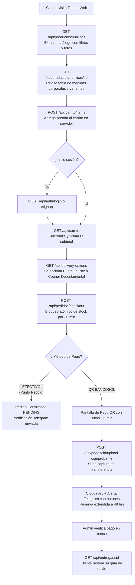

# 🌐 MANUAL DE INTEGRACIÓN Y GUÍA DE ENDPOINTS PARA LA PÁGINA WEB (STOREFRONT & E-COMMERCE)

**Sistema Central:** Fit Andes (`control-ventas`)  
**Audiencia:** Desarrolladores Frontend, Diseñadores UI/UX, Creadores de Interfaces e Integradores de la Tienda Web y Móvil Web.  
**Propósito:** Documento de referencia técnica completa con todas las APIs que la aplicación web (tienda virtual, catálogo público, carrito persistente, checkout con reserva de stock, pasarela de comprobantes QR y portal de post-venta) debe consumir e implementar.

---

## 📑 Índice de Contenidos

1. [Arquitectura Web y Entornos de Conexión](#1-arquitectura-web-y-entornos-de-conexión)
2. [Autenticación, Cabeceras y Seguridad](#2-autenticación-cabeceras-y-seguridad)
3. [Manejo de Errores y Códigos HTTP](#3-manejo-de-errores-y-códigos-http)
4. [Flujo de Compra y Ciclo de Vida del Pedido Web](#4-flujo-de-compra-y-ciclo-de-vida-del-pedido-web)
5. [Módulo 1: Catálogo, Búsqueda y Descubrimiento Público](#5-módulo-1-catálogo-búsqueda-y-descubrimiento-público)
   - [5.1 Salud y Estado del Sistema (`GET /api/estado`)](#51-salud-y-estado-del-sistema-get-apiestado)
   - [5.2 Catálogo Público con Filtros y Paginación (`GET /api/productos/publicos`)](#52-catálogo-público-con-filtros-y-paginación-get-apiproductospublicos)
   - [5.3 Ficha Técnica de Prenda y Medidas Corporales (`GET /api/productos/publicos/:id`)](#53-ficha-técnica-de-prenda-y-medidas-corporales-get-apiproductospublicosid)
   - [5.4 Opciones de Entrega, Horarios y Courier (`GET /api/delivery-options`)](#54-opciones-de-entrega-horarios-y-courier-get-apidelivery-options)
   - [5.5 Políticas Legales y Devoluciones (`GET /api/public/politicas`)](#55-políticas-legales-y-devoluciones-get-apipublicpoliticas)
6. [Módulo 2: Autenticación, Registro y Perfil de Cliente](#6-módulo-2-autenticación-registro-y-perfil-de-cliente)
   - [6.1 Registro de Nueva Cuenta (`POST /api/auth/signup`)](#61-registro-de-nueva-cuenta-post-apiauthsignup)
   - [6.2 Inicio de Sesión Credenciales (`POST /api/auth/login`)](#62-inicio-de-sesión-credenciales-post-apiauthlogin)
   - [6.3 Inicio de Sesión Google OAuth (`POST /api/auth/google`)](#63-inicio-de-sesión-google-oauth-post-apiauthgoogle)
   - [6.4 Perfil del Cliente Autenticado (`GET /api/clientes/me`)](#64-perfil-del-cliente-autenticado-get-apiclientesme)
   - [6.5 Actualización de Perfil y Preferencias (`PUT /api/clientes/me`)](#65-actualización-de-perfil-y-preferencias-put-apiclientesme)
   - [6.6 Libreta de Direcciones de Envío (`GET/POST/PUT/DELETE /api/clientes/me/direcciones`)](#66-libreta-de-direcciones-de-envío-getpostputdelete-apiclientesmedirecciones)
7. [Módulo 3: Carrito de Compras Persistente en Servidor](#7-módulo-3-carrito-de-compras-persistente-en-servidor)
   - [7.1 Obtener Carrito Activo y Subtotales (`GET /api/carrito`)](#71-obtener-carrito-activo-y-subtotales-get-apicarrito)
   - [7.2 Agregar Ítem al Carrito (`POST /api/carrito/items`)](#72-agregar-ítem-al-carrito-post-apicarritoitems)
   - [7.3 Actualizar Cantidad de un Ítem (`PUT/PATCH /api/carrito/items/:itemId`)](#73-actualizar-cantidad-de-un-ítem-putpatch-apicarritoitemsitemid)
   - [7.4 Eliminar Ítem del Carrito (`DELETE /api/carrito/items/:itemId`)](#74-eliminar-ítem-del-carrito-delete-apicarritoitemsitemid)
   - [7.5 Vaciar Todo el Carrito (`DELETE /api/carrito`)](#75-vaciar-todo-el-carrito-delete-apicarrito)
8. [Módulo 4: Checkout y Bloqueo Atómico de Inventario](#8-módulo-4-checkout-y-bloqueo-atómico-de-inventario)
   - [8.1 Proceso de Checkout desde Carrito (`POST /api/pedidos/checkout`)](#81-proceso-de-checkout-desde-carrito-post-apipedidoscheckout)
   - [8.2 Modalidad A: Recojo en Punto de Encuentro (La Paz)](#82-modalidad-a-recojo-en-punto-de-encuentro-la-paz)
   - [8.3 Modalidad B: Envío Nacional por Flota / Courier](#83-modalidad-b-envío-nacional-por-flota--courier)
9. [Módulo 5: Transacciones de Pago y Comprobante QR BancoSol](#9-módulo-5-transacciones-de-pago-y-comprobante-qr-bancosol)
   - [9.1 Crear o Consultar Transacción de Pago (`POST /api/pagos`)](#91-crear-o-consultar-transacción-de-pago-post-apipagos)
   - [9.2 Subir Imagen de Comprobante QR (`POST /api/pagos/:id/upload-comprobante`)](#92-subir-imagen-de-comprobante-qr-post-apipagosidupload-comprobante)
10. [Módulo 6: Post-Venta, Historial, Edición y Seguimiento (Tracking)](#10-módulo-6-post-venta-historial-edición-y-seguimiento-tracking)
    - [10.1 Listar Mis Pedidos (`GET /api/mis-pedidos`)](#101-listar-mis-pedidos-get-apimis-pedidos)
    - [10.2 Detalle de Pedido Individual (`GET /api/mis-pedidos/:id`)](#102-detalle-de-pedido-individual-get-apimis-pedidosid)
    - [10.3 Cancelación Voluntaria y Liberación de Stock (`PATCH /api/pedidos/:id`)](#103-cancelación-voluntaria-y-liberación-de-stock-patch-apipedidosid)
    - [10.4 Actualización de Datos de Entrega (`PATCH /api/pedidos/:id`)](#104-actualización-de-datos-de-entrega-patch-apipedidosid)
    - [10.5 Seguimiento de Guía Logística (`GET /api/entregas/:id`)](#105-seguimiento-de-guía-logística-get-apientregasid)
11. [Guía de Integración Frontend (Snippets y Buenas Prácticas)](#11-guía-de-integración-frontend-snippets-y-buenas-prácticas)

---

## 1. Arquitectura Web y Entornos de Conexión

La tienda web interactúa con el backend central construido sobre **Next.js API Routes** y **MongoDB**.

| Entorno | Base URL de la API |
|---|---|
| **Local / Desarrollo** | `http://localhost:3000/api` |
| **Producción en la Nube (Vercel)** | `https://control-ventas-azure.vercel.app/api` |

### Reglas Clave de Negocio para la Web:
1. **Stock Vendible:** La API pública solo expone prendas y variantes cuyo inventario vendible sea mayor a cero (`stock - stockReservado > 0`) en las sucursales con despacho web activo (`permiteDespachoWeb: true`).
2. **Protección de Datos Comerciales:** Las respuestas para la web ocultan estrictamente precios de costo (`precioCosto`, `costoOrigen`), márgenes de ganancia y códigos internos.
3. **Reserva Atómica de 30 Minutos:** Al hacer checkout web, el inventario queda apartado de inmediato durante **30 minutos**. Si el cliente no sube el comprobante dentro del lapso, el sistema libera las prendas automáticamente.
4. **Extensión a 48 Horas:** Cuando el cliente sube su comprobante bancario QR, la reserva se prorroga automáticamente a 48 horas mientras el administrador valida los fondos.

---

## 2. Autenticación, Cabeceras y Seguridad

### 2.1 Peticiones Públicas (Sin Autenticación)
Para consultar catálogo, ficha de producto, políticas y opciones de transporte:
```http
Accept: application/json
```

### 2.2 Peticiones Autenticadas (Cliente Web)
Para carrito, perfil, checkout, subida de comprobantes e historial de pedidos:
```http
Authorization: Bearer <accessToken>
Content-Type: application/json
Accept: application/json
```

> 💡 **Nota sobre Sesiones NextAuth:**  
> Si tu storefront web corre dentro del mismo dominio Next.js, las solicitudes autenticadas pueden usar directamente la cookie de sesión de NextAuth. Para integraciones desacopladas (SPA React, Astro, Vue, app móvil), utiliza la cabecera `Authorization: Bearer <accessToken>` obtenida en `/api/auth/login`.

---

## 3. Manejo de Errores y Códigos HTTP

El backend responde con códigos de estado HTTP estándar y un formato JSON predecible.

### Error de Validación Zod (`HTTP 400 Bad Request`):
```json
{
  "message": "Datos invalidos",
  "errors": [
    {
      "field": "entrega.telefono",
      "message": "El celular de contacto es obligatorio para el punto de encuentro"
    }
  ]
}
```

### Conflicto de Stock o Inventario Agotado (`HTTP 400` o `HTTP 409`):
```json
{
  "message": "Stock insuficiente para Chompa Alpaca Andina Negro/M",
  "code": "INSUFFICIENT_STOCK"
}
```

### No Autenticado (`HTTP 401 Unauthorized`):
```json
{
  "message": "No autenticado"
}
```

### Prohibido / Rol Incorrecto (`HTTP 403 Forbidden`):
```json
{
  "message": "No autorizado"
}
```

### Límite de Peticiones (`HTTP 429 Too Many Requests`):
```json
{
  "message": "Demasiadas solicitudes. Inténtalo más tarde."
}
```
*Cabecera retornada:* `Retry-After: 60`.

---

## 4. Flujo de Compra y Ciclo de Vida del Pedido Web



---

## 5. Módulo 1: Catálogo, Búsqueda y Descubrimiento Público

Todos los endpoints de este módulo son **públicos** y no requieren token.

### 5.1 Salud y Estado del Sistema (`GET /api/estado`)
Permite comprobar si la API y la base de datos están disponibles para operar.

* **Método:** `GET`
* **Ruta:** `/api/estado`

#### Respuesta Exitosa (`HTTP 200`):
```json
{
  "estado": "ok",
  "timestamp": "2026-10-20T20:30:00.000Z",
  "services": {
    "mongodb": {
      "connected": true,
      "transactionsSupported": true,
      "readOnly": false
    }
  }
}
```

---

### 5.2 Catálogo Público con Filtros y Paginación (`GET /api/productos/publicos`)
Consulta las prendas activas autorizadas para venta en la tienda web.

* **Método:** `GET`
* **Ruta:** `/api/productos/publicos`
* **Rate Limit:** 100 req/min por IP.

#### Parámetros de Consulta (Query Params):
| Parámetro | Tipo | Requerido | Descripción | Ejemplo |
|---|---|---|---|---|
| `q` | `string` | No | Búsqueda por texto (nombre, modelo, SKU) | `?q=alpaca` |
| `categoria` | `string` | No | Filtro por categoría exacta | `?categoria=Chompas` |
| `color` | `string` | No | Filtro por color primario o secundario | `?color=Azul` |
| `talla` | `string` | No | Filtro por talla (`S`, `M`, `L`, `XL`, etc.) | `?talla=M` |
| `soloDisponible` | `boolean` | No | Si es `true`, devuelve prendas con variantes con stock vendible (`> 0`) | `?soloDisponible=true` |
| `page` | `number` | No | Número de página actual (default: 1) | `?page=1` |
| `limit` | `number` | No | Ítems por página (default: 20, máx: 100) | `?limit=12` |

#### Ejemplo de Petición:
```bash
curl -X GET "https://control-ventas-azure.vercel.app/api/productos/publicos?categoria=Chompas&soloDisponible=true&page=1&limit=12" \
  -H "Accept: application/json"
```

#### Respuesta Exitosa (`HTTP 200`):
```json
{
  "data": [
    {
      "_id": "670e10a2f1b4c90012345678",
      "nombre": "Chompa Cuello V Alpaca",
      "modelo": "Andina Clásica",
      "categoria": "Chompas",
      "descripcion": "Chompa de lana de alpaca suave y abrigadora.",
      "marca": "Fit Andes",
      "sku": "CH-ALP-001",
      "precioVenta": 140.00,
      "precioMinimo": 140.00,
      "precioMaximo": 150.00,
      "tieneRangoPrecios": true,
      "precioDisplay": "Bs 140.00 - Bs 150.00",
      "descuento": 0,
      "stockTotal": 12,
      "stockReservadoTotal": 1,
      "stockDisponible": 11,
      "estado": "ACTIVO",
      "variantes": [
        {
          "varianteId": "670e10a2f1b4c90012345679",
          "color": "Negro",
          "colorSecundario": "Gris",
          "talla": "M",
          "precioVenta": 140.00,
          "stock": 6,
          "stockReservado": 1,
          "stockDisponible": 5,
          "imagenes": [
            "https://res.cloudinary.com/dq1jeikev/image/upload/v1728864000/chompa_negra_1.jpg",
            "https://res.cloudinary.com/dq1jeikev/image/upload/v1728864000/chompa_negra_2.jpg"
          ],
          "medidas": {
            "anchoPecho": 52,
            "anchoHombros": 44,
            "largoTotal": 68,
            "largoMangaAxila": 49,
            "largoMangaHombro": 62
          }
        },
        {
          "varianteId": "670e10a2f1b4c90012345680",
          "color": "Negro",
          "colorSecundario": "Gris",
          "talla": "XL",
          "precioVenta": 150.00,
          "stock": 6,
          "stockReservado": 0,
          "stockDisponible": 6,
          "imagenes": [
            "https://res.cloudinary.com/dq1jeikev/image/upload/v1728864000/chompa_negra_1.jpg"
          ],
          "medidas": {
            "anchoPecho": 58,
            "anchoHombros": 48,
            "largoTotal": 72,
            "largoMangaAxila": 52,
            "largoMangaHombro": 65
          }
        }
      ]
    }
  ],
  "total": 1,
  "page": 1,
  "limit": 12,
  "totalPages": 1
}
```

---

### 5.3 Ficha Técnica de Prenda y Medidas Corporales (`GET /api/productos/publicos/:id`)
Devuelve la ficha detallada de un producto por su `_id`, incluyendo variantes, fotos en alta resolución y la tabla anatómica de medidas en centímetros.

* **Método:** `GET`
* **Ruta:** `/api/productos/publicos/:id`
* **Parámetros de Ruta:** `:id` (ObjectId de 24 caracteres hex del producto).

#### Respuesta Exitosa (`HTTP 200`):
Retorna el objeto individual del producto idéntico a la estructura mostrada en el listado, garantizando que los precios por variante y las medidas en cm estén completamente disponibles para renderizar el recomendador o selector de tallas.

---

### 5.4 Opciones de Entrega, Horarios y Courier (`GET /api/delivery-options`)
Retorna los puntos de encuentro físicos en la ciudad de La Paz (estaciones de teleférico, plazas céntricas) con sus días y franjas horarias oficiales, así como las empresas de transporte interdepartamental y sus terminales.

* **Método:** `GET`
* **Ruta:** `/api/delivery-options`

#### Ejemplo de Petición:
```bash
curl -X GET https://control-ventas-azure.vercel.app/api/delivery-options \
  -H "Accept: application/json"
```

#### Respuesta Exitosa (`HTTP 200`):
```json
{
  "pickupPoints": [
    {
      "id": "teleferico-central",
      "name": "Estación Teleférico Central (Línea Roja - Av. Manco Cápac)"
    },
    {
      "id": "plaza-estudiante",
      "name": "Plaza del Estudiante (El Prado)"
    },
    {
      "id": "teleferico-iglesias",
      "name": "Estación Teleférico Iglesia del Carmen (Línea Morada - Obelisco)"
    }
  ],
  "pickupSchedules": [
    {
      "id": "mar-jue-15-18",
      "day": "Martes y Jueves",
      "start": "15:00",
      "end": "18:00",
      "label": "Martes y Jueves: 15:00 a 18:00"
    },
    {
      "id": "sab-10-14",
      "day": "Sábados",
      "start": "10:00",
      "end": "14:00",
      "label": "Sábados: 10:00 a 14:00"
    }
  ],
  "shippingCompanies": [
    {
      "id": "bolivar-cargo",
      "name": "Bolivar Cargo",
      "departments": [
        {
          "name": "Cochabamba",
          "branches": [
            "Terminal Central Cochabamba",
            "Av. Blanco Galindo Km 4"
          ]
        },
        {
          "name": "Santa Cruz",
          "branches": [
            "Terminal Bimodal Santa Cruz (Plataforma 12)",
            "Sucursal Plan 3000"
          ]
        },
        {
          "name": "Oruro",
          "branches": [
            "Terminal de Buses Oruro"
          ]
        }
      ]
    }
  ]
}
```

---

### 5.5 Políticas Legales y Devoluciones (`GET /api/public/politicas`)
Provee las políticas dinámicas de la empresa configuradas desde administración (plazo máximo de cambio, privacidad y términos de venta).

* **Método:** `GET`
* **Ruta:** `/api/public/politicas`

#### Respuesta Exitosa (`HTTP 200`):
```json
{
  "devoluciones": {
    "titulo": "Políticas de Devolución y Cambios",
    "contenido": "Tienes hasta 7 días para solicitar un cambio de talla presentando la prenda sin uso y en perfecto estado.",
    "diasLimiteDevolucion": 7,
    "version": "1.0",
    "activo": true
  },
  "privacidad": {
    "titulo": "Política de Privacidad",
    "contenido": "Tus datos personales son utilizados exclusivamente para la facturación y el despacho de tus pedidos.",
    "version": "1.0",
    "activo": true
  },
  "terminos": {
    "titulo": "Términos y Condiciones de Uso",
    "contenido": "Todos los precios están expresados en Bolivianos (Bs). La reserva de compra web se garantiza por 30 minutos.",
    "version": "1.0",
    "activo": true
  }
}
```

---

## 6. Módulo 2: Autenticación, Registro y Perfil de Cliente

### 6.1 Registro de Nueva Cuenta (`POST /api/auth/signup`)
Crea una nueva cuenta de cliente con rol `CLIENTE`.

* **Método:** `POST`
* **Ruta:** `/api/auth/signup`
* **Rate Limit:** 5 req/min por IP.

#### Payload:
```json
{
  "nombreCompleto": "Daniela Vargas",
  "email": "daniela.vargas@gmail.com",
  "password": "PasswordSeguro2026!"
}
```

#### Respuesta Exitosa (`HTTP 201 Created`):
```json
{
  "message": "Usuario creado exitosamente",
  "user": {
    "id": "670e23a1f1b4c90098765432",
    "nombreCompleto": "Daniela Vargas",
    "email": "daniela.vargas@gmail.com",
    "rol": "CLIENTE"
  }
}
```

---

### 6.2 Inicio de Sesión Credenciales (`POST /api/auth/login`)
Autentica con email y contraseña. Retorna un JWT de acceso de 24 horas y los datos del usuario.

* **Método:** `POST`
* **Ruta:** `/api/auth/login`
* **Rate Limit:** 5 req/min por IP.

#### Payload:
```json
{
  "email": "daniela.vargas@gmail.com",
  "password": "PasswordSeguro2026!"
}
```

#### Respuesta Exitosa (`HTTP 200 OK`):
```json
{
  "accessToken": "eyJhbGciOiJIUzI1NiIsInR5cCI6IkpXVCJ9.eyJpZCI6IjY3MGUyM2ExZjFiNGM5MDA5ODc2NTQzMiIsImVtYWlsIjoiZGFuaWVsYS52YXJnYXNAZ21haWwuY29tIiwibm9tYnJlQ29tcGxldG8iOiJEYW5pZWxhIFZhcmdhcyIsInJvbCI6IkNMSUVOVEUiLCJpYXQiOjE3Mjg4NjQwMDAsImV4cCI6MTcyODk1MDQwMH0.XXXXX",
  "user": {
    "id": "670e23a1f1b4c90098765432",
    "email": "daniela.vargas@gmail.com",
    "nombreCompleto": "Daniela Vargas",
    "rol": "CLIENTE"
  }
}
```

---

### 6.3 Inicio de Sesión Google OAuth (`POST /api/auth/google`)
Permite iniciar sesión con un solo clic con Google. Si el correo no existe en el sistema, se crea automáticamente un usuario con rol `CLIENTE`.

* **Método:** `POST`
* **Ruta:** `/api/auth/google`
* **Payload:**
```json
{
  "idToken": "eyJhbGciOiJSUzI1NiIsImtpZCI6IjEyMzQ1NiIsImFsZyI6IlJTMjU2In0.eyJpc3MiOiJodHRwczovL2FjY291bnRzLmdvb2dsZS5jb20i..."
}
```
* **Respuesta:** Mismo formato con `accessToken` y `user` que `/api/auth/login`.

---

### 6.4 Perfil del Cliente Autenticado (`GET /api/clientes/me`)
Retorna los datos del usuario autenticado, su perfil complementario (documento, teléfono) y su dirección predeterminada.

* **Método:** `GET`
* **Ruta:** `/api/clientes/me`
* **Cabecera Requerida:** `Authorization: Bearer <accessToken>`

#### Respuesta Exitosa (`HTTP 200`):
```json
{
  "user": {
    "_id": "670e23a1f1b4c90098765432",
    "nombreCompleto": "Daniela Vargas",
    "email": "daniela.vargas@gmail.com",
    "rol": "CLIENTE"
  },
  "profile": {
    "_id": "670e23b5f1b4c90098765433",
    "telefono": "59178965412",
    "tipoDocumento": "CI",
    "numeroDocumento": "8765432 LP",
    "metodoEntregaPredeterminado": "PICKUP_POINT"
  },
  "defaultAddress": {
    "_id": "670e23d0f1b4c90098765434",
    "etiqueta": "Casa",
    "nombreDestinatario": "Daniela Vargas",
    "telefono": "59178965412",
    "departamento": "La Paz",
    "ciudad": "La Paz",
    "direccion": "Av. Montenegro Nro 1234, San Miguel",
    "esPredeterminada": true
  }
}
```

---

### 6.5 Actualización de Perfil y Preferencias (`PUT /api/clientes/me`)
Permite al cliente actualizar su nombre, teléfono, documento de identidad o método de entrega preferido.

* **Método:** `PUT`
* **Ruta:** `/api/clientes/me`
* **Cabecera Requerida:** `Authorization: Bearer <accessToken>`

#### Payload:
```json
{
  "nombreCompleto": "Daniela Vargas Romero",
  "telefono": "59178965412",
  "tipoDocumento": "CI",
  "numeroDocumento": "8765432 LP",
  "metodoEntregaPredeterminado": "SHIPPING_NATIONAL"
}
```

---

### 6.6 Libreta de Direcciones de Envío (`GET/POST/PUT/DELETE /api/clientes/me/direcciones`)

* **`GET /api/clientes/me/direcciones`**: Lista todas las direcciones guardadas por el cliente.
* **`POST /api/clientes/me/direcciones`**: Guarda una nueva dirección en la libreta.
  ```json
  {
    "etiqueta": "Oficina Centro",
    "nombreDestinatario": "Daniela Vargas",
    "telefono": "78965412",
    "departamento": "La Paz",
    "ciudad": "La Paz",
    "zona": "San Jorge",
    "direccion": "Av. Arce, Edificio Multicentro Torre B, Piso 10",
    "referencia": "Frente a la plaza Isabel La Católica",
    "esPredeterminada": true
  }
  ```
* **`PUT /api/clientes/me/direcciones/:direccionId`** (o `PATCH`): Actualiza una dirección guardada existente (admite modificar `etiqueta`, `nombreDestinatario`, `telefono`, `departamento`, `ciudad`, `zona`, `direccion`, `referencia`, `codigoPostal`, `esPredeterminada`).
  ```json
  {
    "telefono": "78965499",
    "referencia": "Frente a la plaza Isabel La Católica, Torre B Oficina 1002",
    "esPredeterminada": true
  }
  ```
* **`DELETE /api/clientes/me/direcciones/:direccionId`**: Elimina una dirección guardada por su ObjectId.

---

## 7. Módulo 3: Carrito de Compras Persistente en Servidor

El carrito reside en la base de datos de MongoDB asociado al `id` del cliente. Si el usuario cierra el navegador o cambia de dispositivo, sus prendas continúan guardadas.

> 🔒 **Requiere:** `Authorization: Bearer <accessToken>` (Rol `CLIENTE`).

### 7.1 Obtener Carrito Activo y Subtotales (`GET /api/carrito`)
Devuelve los ítems agregados con fotos, nombres, precios y el cálculo del subtotal.

* **Método:** `GET`
* **Ruta:** `/api/carrito`

#### Respuesta Exitosa (`HTTP 200`):
```json
{
  "_id": "670e24aaf1b4c90098765440",
  "cliente": "670e23a1f1b4c90098765432",
  "items": [
    {
      "_id": "item-670e24aaf1b4",
      "productoId": "670e10a2f1b4c90012345678",
      "variante": {
        "varianteId": "670e10a2f1b4c90012345679",
        "color": "Negro",
        "colorSecundario": "Gris",
        "talla": "M"
      },
      "productoSnapshot": {
        "nombre": "Chompa Cuello V Alpaca",
        "sku": "CH-ALP-001",
        "imagen": "https://res.cloudinary.com/dq1jeikev/image/upload/v1728864000/chompa_negra_1.jpg"
      },
      "precioUnitario": 140.00,
      "cantidad": 2,
      "subtotal": 280.00
    }
  ],
  "totalArticulos": 2,
  "subtotal": 280.00
}
```

---

### 7.2 Agregar Ítem al Carrito (`POST /api/carrito/items`)
Agrega una prenda validando en tiempo real que exista stock vendible (`stockDisponible >= cantidad`).

* **Método:** `POST`
* **Ruta:** `/api/carrito/items`

#### Payload:
```json
{
  "productoId": "670e10a2f1b4c90012345678",
  "varianteId": "670e10a2f1b4c90012345679",
  "color": "Negro",
  "colorSecundario": "Gris",
  "talla": "M",
  "cantidad": 1
}
```

#### Respuestas:
* **`HTTP 200 OK`**: Retorna el objeto actualizado del carrito con el nuevo ítem y los subtotales recalculados.
* **`HTTP 400 Bad Request`**: Si la cantidad solicitada excede las existencias físicas menos las reservas activas.

---

### 7.3 Actualizar Cantidad de un Ítem (`PUT /api/carrito/items/:itemId`)
Modifica la cantidad de unidades de un ítem ya presente en el carrito. Admite tanto `PUT` como `PATCH`.

* **Método:** `PUT` (o `PATCH`)
* **Ruta:** `/api/carrito/items/:itemId` (donde `:itemId` es el `_id` del ítem dentro del array del carrito).

#### Payload:
```json
{
  "cantidad": 3
}
```

---

### 7.4 Eliminar Ítem del Carrito (`DELETE /api/carrito/items/:itemId`)
Remueve una prenda específica del carrito y recalcula el monto total.

* **Método:** `DELETE`
* **Ruta:** `/api/carrito/items/:itemId`

---

### 7.5 Vaciar Todo el Carrito (`DELETE /api/carrito`)
Limpia todos los productos del carrito del cliente actual.

* **Método:** `DELETE`
* **Ruta:** `/api/carrito`

---

## 8. Módulo 4: Checkout y Bloqueo Atómico de Inventario

El endpoint de checkout es la operación central de compra. En una sola transacción ACID de MongoDB:
1. Valida que todas las prendas del carrito tengan stock vendible.
2. Incrementa `stockReservado` en la sucursal de despacho web (`stockReservado = stockReservado + cantidad`).
3. Vacía automáticamente el carrito del usuario.
4. Crea el documento `Pedido` con estado `PENDING_PAYMENT` y `estadoReservaStock: "RESERVED"`.
5. Fija el vencimiento de la reserva exactamente a **30 minutos** (`reservaExpiraEn: now + 30m`).

> 🔒 **Requiere:** `Authorization: Bearer <accessToken>` (Rol `CLIENTE`).

---

### 8.1 Proceso de Checkout desde Carrito (`POST /api/pedidos/checkout`)

* **Método:** `POST`
* **Ruta:** `/api/pedidos/checkout`

---

### 8.2 Modalidad A: Recojo en Punto de Encuentro (La Paz)
Ideal para entregas presenciales en estaciones de teleférico o plazas de La Paz. Permite pago por **QR** o **EFECTIVO** al momento del encuentro.

#### Payload Ejemplo:
```json
{
  "metodoPago": "QR",
  "entrega": {
    "metodo": "PICKUP_POINT",
    "direccion": "Estación Teleférico Central (Línea Roja - Av. Manco Cápac)",
    "telefono": "59178965412",
    "nombreDestinatario": "Daniela Vargas",
    "programadoPara": "Sábados: 10:00 a 14:00"
  },
  "notas": "Por favor coordinar entrega por WhatsApp 15 minutos antes."
}
```

#### Campos Requeridos para `PICKUP_POINT`:
* `entrega.metodo`: `"PICKUP_POINT"`
* `entrega.direccion`: Lugar de encuentro (ej. Teleférico Central).
* `entrega.telefono`: Celular de contacto para coordinar la entrega.
* `entrega.nombreDestinatario`: Nombre de la persona que recoge.

---

### 8.3 Modalidad B: Envío Nacional por Flota / Courier
Diseñado para envíos a Cochabamba, Santa Cruz, Oruro, Sucre, Tarija, etc.  
> ⚠️ **Regla Obligatoria:** Si el método de entrega es `SHIPPING_NATIONAL`, el `metodoPago` debe ser **obligatoriamente `"QR"`** (no se admite pago en efectivo para envíos interdepartamentales).

#### Payload Ejemplo:
```json
{
  "metodoPago": "QR",
  "entrega": {
    "metodo": "SHIPPING_NATIONAL",
    "departamento": "Cochabamba",
    "ciudad": "Cochabamba",
    "empresaEnvio": "Bolivar Cargo",
    "sucursal": "Terminal Central Cochabamba",
    "nombreRemitente": "Daniela Vargas Romero",
    "ciRemitente": "8765432 LP",
    "telefonoRemitente": "59178965412"
  },
  "notas": "Retiro personal en encomiendas con carnet de identidad."
}
```

#### Campos Requeridos para `SHIPPING_NATIONAL`:
* `entrega.departamento`: Departamento de destino.
* `entrega.empresaEnvio`: Empresa de transporte (ej. `Bolivar Cargo`).
* `entrega.nombreRemitente`: Nombre de la persona que retirará el paquete en ventanilla.
* `entrega.ciRemitente`: Carnet de identidad del consignatario para la guía de encomienda.
* `entrega.telefonoRemitente`: Celular del consignatario.

#### Respuesta Exitosa (`HTTP 201 Created`):
```json
{
  "message": "Pedido creado correctamente desde el carrito",
  "pedido": {
    "_id": "670e3001f1b4c90011223344",
    "numeroPedido": "P-261020-001",
    "canal": "WEB",
    "estadoPedido": "PENDING_PAYMENT",
    "estadoPago": "PENDING",
    "estadoEntrega": "PENDING",
    "estadoReservaStock": "RESERVED",
    "reservaExpiraEn": "2026-10-20T21:00:00.000Z",
    "metodoPago": "QR",
    "subtotal": 280.00,
    "descuento": 0.00,
    "total": 280.00,
    "items": [
      {
        "productoId": "670e10a2f1b4c90012345678",
        "variante": {
          "color": "Negro",
          "colorSecundario": "Gris",
          "talla": "M"
        },
        "productoSnapshot": {
          "nombre": "Chompa Cuello V Alpaca",
          "sku": "CH-ALP-001",
          "imagen": "https://res.cloudinary.com/dq1jeikev/image/upload/v1728864000/chompa_negra_1.jpg"
        },
        "cantidad": 2,
        "precioUnitario": 140.00,
        "totalLinea": 280.00
      }
    ],
    "snapshotEntrega": {
      "metodo": "SHIPPING_NATIONAL",
      "departamento": "Cochabamba",
      "ciudad": "Cochabamba",
      "empresaEnvio": "Bolivar Cargo",
      "sucursal": "Terminal Central Cochabamba",
      "nombreRemitente": "Daniela Vargas Romero",
      "ciRemitente": "8765432 LP",
      "telefonoRemitente": "59178965412"
    }
  }
}
```

---

## 9. Módulo 5: Transacciones de Pago y Comprobante QR BancoSol

Cuando el cliente elige pagar con QR BancoSol, la tienda web debe:
1. Crear el registro de la transacción de pago (o recibir el ID generado).
2. Mostrar en pantalla el código QR oficial de BancoSol y el temporizador con la cuenta regresiva de **30 minutos**.
3. Proveer un botón interactivo para que el usuario suba la captura o foto del comprobante emitido por su app bancaria.

---

### 9.1 Crear o Consultar Transacción de Pago (`POST /api/pagos`)
Genera la transacción en estado `PENDING` asociada al pedido.

* **Método:** `POST`
* **Ruta:** `/api/pagos`
* **Cabecera Requerida:** `Authorization: Bearer <accessToken>`

#### Payload:
```json
{
  "pedidoId": "670e3001f1b4c90011223344",
  "metodoPago": "QR",
  "idempotencyKey": "web-checkout-670e3001f1b4-v1",
  "referenciaExterna": "cliente-bancosol-ref"
}
```

#### Respuesta Exitosa (`HTTP 201 Created`):
```json
{
  "message": "Transaccion de pago creada correctamente",
  "payment": {
    "_id": "670e3002f1b4c90011223345",
    "numeroPago": "PAY-261020-001",
    "pedidoId": "670e3001f1b4c90011223344",
    "metodoPago": "QR",
    "monto": 280.00,
    "estado": "PENDING",
    "urlComprobante": null
  }
}
```

---

### 9.2 Subir Imagen de Comprobante QR (`POST /api/pagos/:id/upload-comprobante`)
El cliente adjunta la captura de su transferencia bancaria.

#### Efectos Inmediatos en el Backend Central:
1. Sube el archivo a **Cloudinary** en la carpeta `control-ventas/comprobantes`.
2. Asocia la URL en `TransaccionPago.urlComprobante`.
3. Genera un token criptográfico de revisión de un solo uso (`tokenRevision`).
4. **Extiende automáticamente la reserva de stock a 48 horas** mientras el staff revisa la cuenta.
5. Envía un mensaje con la imagen del comprobante y botones interactivos ("Aprobar Pago" / "Rechazar") al canal de **Telegram** de los administradores.

* **Método:** `POST`
* **Ruta:** `/api/pagos/:id/upload-comprobante` (donde `:id` es el `_id` de la `TransaccionPago`).
* **Content-Type:** `multipart/form-data`
* **Campo Form-Data:** `file` (archivo de imagen JPG/PNG, tamaño máximo **5 MB**).

#### Ejemplo de Petición cURL:
```bash
curl -X POST "https://control-ventas-azure.vercel.app/api/pagos/670e3002f1b4c90011223345/upload-comprobante" \
  -H "Authorization: Bearer <accessToken>" \
  -F "file=@/ruta/captura_pago_bancosol.png"
```

#### Respuesta Exitosa (`HTTP 201 Created`):
```json
{
  "message": "Comprobante subido correctamente. El administrador fue notificado.",
  "urlComprobante": "https://res.cloudinary.com/dq1jeikev/image/upload/v1728864500/control-ventas/comprobantes/comp_x9123.jpg"
}
```

---

## 10. Módulo 6: Post-Venta, Historial, Edición y Seguimiento (Tracking)

### 10.1 Listar Mis Pedidos (`GET /api/mis-pedidos`)
Devuelve el listado completo de pedidos realizados por el cliente autenticado.

* **Método:** `GET`
* **Ruta:** `/api/mis-pedidos`
* **Cabecera:** `Authorization: Bearer <accessToken>`

#### Respuesta Exitosa (`HTTP 200`):
```json
[
  {
    "_id": "670e3001f1b4c90011223344",
    "numeroPedido": "P-261020-001",
    "canal": "WEB",
    "estadoPedido": "CONFIRMED",
    "estadoPago": "PAID",
    "estadoEntrega": "IN_TRANSIT",
    "total": 280.00,
    "createdAt": "2026-10-20T20:30:00.000Z",
    "items": [
      {
        "productoSnapshot": { "nombre": "Chompa Cuello V Alpaca" },
        "variante": { "color": "Negro", "talla": "M" },
        "cantidad": 2,
        "precioUnitario": 140.00,
        "totalLinea": 280.00
      }
    ]
  }
]
```

---

### 10.2 Detalle de Pedido Individual (`GET /api/mis-pedidos/:id`)
Devuelve la información pormenorizada de una compra (reserva, snapshot de entrega, fechas de creación).

* **Método:** `GET`
* **Ruta:** `/api/mis-pedidos/:id` (donde `:id` es el ObjectId del pedido).
* **Seguridad:** Retorna `HTTP 403 Forbidden` si el pedido pertenece a otro usuario.

---

### 10.3 Cancelación Voluntaria y Liberación de Stock (`PATCH /api/pedidos/:id`)
El cliente puede cancelar su compra voluntariamente mientras el estado sea `PENDING_PAYMENT`. Al hacerlo, el backend libera inmediatamente las existencias reservadas (`stockReservado = stockReservado - cantidad`, `estadoReservaStock: "RELEASED"`).

* **Método:** `PATCH`
* **Ruta:** `/api/pedidos/:id`
* **Payload:**
```json
{
  "estadoPedido": "CANCELLED"
}
```

#### Respuesta Exitosa (`HTTP 200`):
```json
{
  "message": "Pedido actualizado correctamente",
  "pedido": {
    "_id": "670e3001f1b4c90011223344",
    "numeroPedido": "P-261020-001",
    "estadoPedido": "CANCELLED",
    "estadoPago": "FAILED",
    "estadoReservaStock": "RELEASED"
  }
}
```

---

### 10.4 Actualización de Datos de Entrega (`PATCH /api/pedidos/:id`)
Permite al cliente corregir su número de celular, lugar de encuentro o datos de encomienda durante los **primeros 30 minutos** posteriores a la creación del pedido, siempre que continúe en estado `PENDING_PAYMENT`.

* **Método:** `PATCH`
* **Ruta:** `/api/pedidos/:id`
* **Payload:**
```json
{
  "entrega": {
    "telefono": "59167113105",
    "puntoRecojo": "Plaza del Estudiante (El Prado)",
    "notas": "Llegaré a las 11:30 am con chamarra azul"
  }
}
```

---

### 10.5 Seguimiento de Guía Logística (`GET /api/entregas/:id`)
Permite consultar en tiempo real el estado de despacho del paquete (código de guía de transporte, transportista asignado y marcas de tiempo).

* **Método:** `GET`
* **Ruta:** `/api/entregas/:id` (donde `:id` es el `_id` del Pedido).
* **Cabecera:** `Authorization: Bearer <accessToken>`

#### Respuesta Exitosa (`HTTP 200`):
```json
{
  "_id": "670e3005f1b4c90011223399",
  "pedidoId": "670e3001f1b4c90011223344",
  "numeroPedido": "P-261020-001",
  "canal": "WEB",
  "metodo": "SHIPPING_NATIONAL",
  "estado": "IN_TRANSIT",
  "codigoSeguimiento": "GUIA-BOLIVAR-99881",
  "nombreTransportista": "Bolivar Cargo",
  "telefono": "59178965412",
  "nombreDestinatario": "Daniela Vargas Romero",
  "preparadoEn": "2026-10-21T08:00:00.000Z",
  "enTransitoEn": "2026-10-21T10:30:00.000Z",
  "entregadoEn": null
}
```

#### Estados del Despacho (`estado`):
* `PENDING`: En cola de almacén web.
* `PREPARING`: Empaquetado y rotulado en almacén.
* `IN_TRANSIT`: Despachado en la flota / courier (guía activa).
* `DELIVERED`: Entregado satisfactoriamente al cliente.

---

## 11. Guía de Integración Frontend (Snippets y Buenas Prácticas)

### 11.1 Cliente API con Fetch e Inyección de Token (TypeScript)

```typescript
// services/apiClient.ts
const BASE_URL = process.env.NEXT_PUBLIC_API_URL || 'https://control-ventas-azure.vercel.app/api';

export async function apiFetch<T>(endpoint: string, options: RequestInit = {}): Promise<T> {
  const token = typeof window !== 'undefined' ? localStorage.getItem('token') : null;

  const headers = new Headers(options.headers || {});
  headers.set('Accept', 'application/json');

  if (token) {
    headers.set('Authorization', `Bearer ${token}`);
  }

  if (options.body && !(options.body instanceof FormData)) {
    headers.set('Content-Type', 'application/json');
  }

  const response = await fetch(`${BASE_URL}${endpoint}`, {
    ...options,
    headers,
  });

  const data = await response.json();

  if (!response.ok) {
    throw new Error(data.message || 'Error en la petición al servidor');
  }

  return data as T;
}
```

---

### 11.2 Temporizador de Reserva de 30 Minutos (React Hook)

```tsx
// hooks/useReservationTimer.ts
import { useState, useEffect } from 'react';

export function useReservationTimer(expiresAtIsoString: string) {
  const [timeLeft, setTimeLeft] = useState<{ minutes: number; seconds: number; isExpired: boolean }>({
    minutes: 0,
    seconds: 0,
    isExpired: false,
  });

  useEffect(() => {
    const target = new Date(expiresAtIsoString).getTime();

    const interval = setInterval(() => {
      const now = new Date().getTime();
      const difference = target - now;

      if (difference <= 0) {
        clearInterval(interval);
        setTimeLeft({ minutes: 0, seconds: 0, isExpired: true });
      } else {
        const minutes = Math.floor((difference % (1000 * 60 * 60)) / (1000 * 60));
        const seconds = Math.floor((difference % (1000 * 60)) / 1000);
        setTimeLeft({ minutes, seconds, isExpired: false });
      }
    }, 1000);

    return () => clearInterval(interval);
  }, [expiresAtIsoString]);

  return timeLeft;
}
```

---

### 11.3 Función para Subir Comprobante Bancario QR (TypeScript)

```typescript
// services/paymentService.ts
import { apiFetch } from './apiClient';

export async function uploadPaymentProof(paymentId: string, imageFile: File) {
  const formData = new FormData();
  formData.append('file', imageFile);

  return apiFetch<{ message: string; urlComprobante: string }>(
    `/pagos/${paymentId}/upload-comprobante`,
    {
      method: 'POST',
      body: formData,
    }
  );
}
```

---

### 11.4 Resumen de Estados de Pedidos para el Frontend

| Estado del Pedido (`estadoPedido`) | Estado del Pago (`estadoPago`) | Estado de Reserva (`estadoReservaStock`) | Significado para la UI | Acción Recomendada para el Usuario |
|---|---|---|---|---|
| `PENDING_PAYMENT` | `PENDING` | `RESERVED` | Pedido creado, prendas bloqueadas por 30 min | Mostrar QR BancoSol y botón para subir comprobante |
| `PENDING_PAYMENT` | `PENDING` | `RESERVED` *(48h)* | Comprobante subido, en verificación admin | Mostrar mensaje: "Verificando transferencia bancaria" |
| `CONFIRMED` | `PAID` | `CONSUMED` | Pago verificado e ingresado a caja | Mostrar: "Pago aprobado. En preparación" |
| `CANCELLED` | `FAILED` | `RELEASED` | Cancelado o tiempo de 30 min expirado | Mostrar: "Pedido cancelado. Stock liberado" |

---

> 📌 **¿Dudas o nuevas integraciones?**  
> Para consultas sobre la API omnicanal, contacta al equipo de desarrollo central o revisa también [ENDPOINTS_PUBLICOS_Y_EXTERNOS.md](file:///c:/proyectos/control-ventas/ENDPOINTS_PUBLICOS_Y_EXTERNOS.md) y [GUIA_AGENTE_WHATSAPP_ENDPOINTS.md](file:///c:/proyectos/control-ventas/GUIA_AGENTE_WHATSAPP_ENDPOINTS.md).
